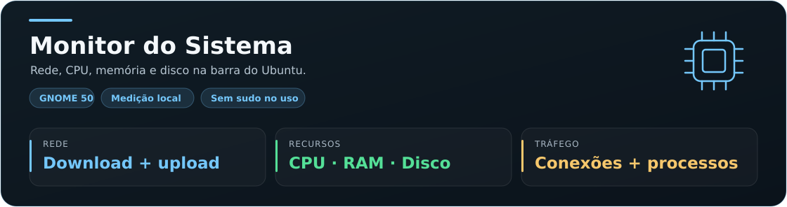
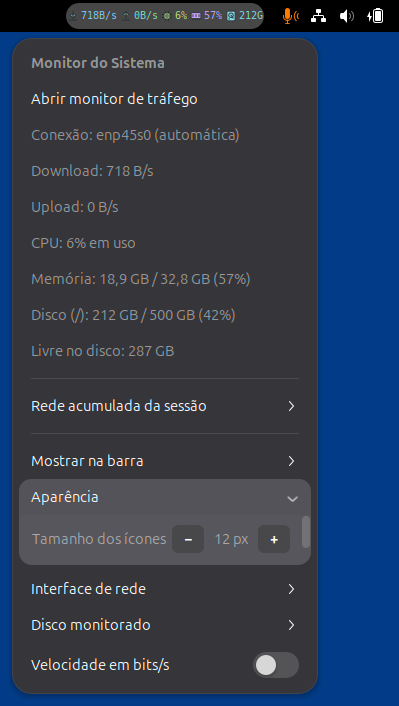
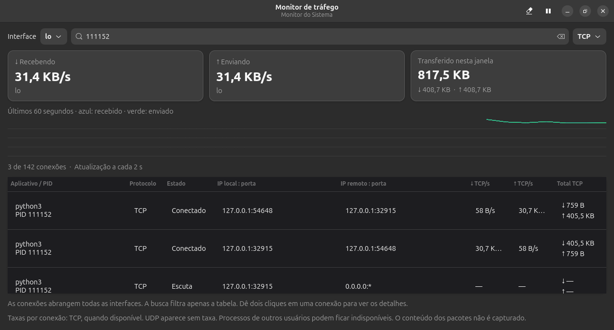

# 🖥️ Monitor do Sistema



**Veja o uso do computador sem sair do que está fazendo.**

Extensão compacta para a barra superior do **Ubuntu / GNOME 50**, com download,
upload, CPU, memória RAM e espaço ocupado no disco. Clique no indicador para
abrir os detalhes, escolher o que mostrar e personalizar a aparência.

[Prints](#-em-funcionamento) · [Começar](#-instalar-ou-atualizar) · [Indicadores](#-o-que-cada-número-significa) · [Tráfego](#-monitor-de-tráfego) · [Aparência](#-deixe-do-seu-jeito) · [Ajuda](#-dúvidas-e-soluções) · [Desenvolvimento](#-desenvolvimento-e-validação)

---

## ✨ Recursos em destaque

| Recurso | O que você encontra |
| :--- | :--- |
| 🔽 Download e upload | Velocidade atual da interface automática ou selecionada. |
| ⚙️ CPU | Utilização agregada do processador, de 0 a 100%. |
| 🧠 Memória RAM | Uso percentual e valores absolutos no menu. |
| 💽 Disco | Espaço ocupado, livre e total do sistema de arquivos monitorado. |
| 🔢 Rede acumulada | Recebido, enviado e soma da sessão, com opção de zerar. |
| 🔎 Monitor de tráfego | Conexões TCP/UDP, processos, IPs, portas e gráfico da interface. |
| 🎨 Aparência | Ícones, texto, tamanhos, espaçamento e cores de uso elevado. |
| 🔒 Leituras locais | Sem envio de dados, histórico em disco ou consultas externas. |

Exemplo ilustrativo no modo de identificação por texto:

```text
↓4,2M/s  ↑350K/s  CPU12%  RAM48%  D180G
```

O padrão usa **ícones + números**. Os indicadores podem ser ligados e desligados
individualmente; seus detalhes continuam disponíveis no menu.

## 📸 Em funcionamento

Capturas reais da extensão e da janela nativa em uma sessão GNOME isolada,
em **17/11/2026**. As leituras representam o computador no momento da captura.

### Indicadores, detalhes e aparência

Rede, CPU, RAM e disco na barra; o menu reúne leituras detalhadas, opções de
visibilidade e controles de tamanho dos ícones.



<details>
<summary><strong>Ver a janela do monitor de tráfego</strong></summary>

### Conexões e gráfico de tráfego

Para esta captura, foram criadas conexões TCP reais em **localhost**. A busca
filtra o PID do processo de teste, e o gráfico acompanha a interface `lo`.
Assim, a imagem demonstra as taxas e os contadores sem listar conexões remotas
da sessão de uso diário.



</details>

## 🚀 Instalar ou atualizar

Execute na sua sessão de usuário:

```bash
cd /var/www/html/sys-monitor
python3 instalar-monitor-sistema.py
```

O instalador utiliza o ZIP incluído no projeto, **sem downloads e sem sudo**.
Antes de uma atualização, cria um backup da extensão instalada em
`monitor-sistema/backups/anterior-…`. As preferências existentes são mantidas,
as outras extensões são preservadas e a ativação fica salva para o próximo login.

> **Depois de instalar ou atualizar:** salve o trabalho e saia/entre na sessão do
> Ubuntu se a extensão não aparecer ou o código antigo continuar carregado.
> O instalador não encerra a sessão. Não é necessário reiniciar o computador.

### Requisitos

| Componente | Utilização |
| :--- | :--- |
| GNOME Shell 50 e GJS | Indicador da barra superior. |
| Python 3 + PyGObject | Janela nativa do monitor de tráfego. |
| GTK 4 + libadwaita | Interface da janela. |
| `ss` do pacote `iproute2` | Consulta das conexões locais. |

O instalador confere as dependências antes de atualizar. **Node.js e servidor web
não são necessários.** O monitor funciona localmente, inclusive sem internet.

### Primeiro uso

1. Clique no indicador da barra para abrir o menu.
2. Em **Mostrar na barra**, escolha download, upload, CPU, RAM, disco e acumulado.
3. Confira **Interface de rede**: automática pela rota padrão ou escolha manual.
4. Em **Disco monitorado**, escolha o sistema (`/`) ou a pasta pessoal.
5. Abra **Aparência** para ajustar a apresentação ou **Abrir monitor de tráfego**
   para investigar conexões.

## 📊 O que cada número significa

| Indicador | Interpretação | Atualização |
| :--- | :--- | :--- |
| Download / upload | Diferença dos bytes recebidos/enviados na interface, dividida pelo tempo decorrido. | 1 s. |
| CPU | Percentual de processamento ativo do conjunto de núcleos; a primeira leitura estabelece a base. | Ciclo de leitura da barra. |
| RAM | `MemTotal − MemAvailable`, mantendo como disponível a memória recuperável pelo kernel. | Ciclo de leitura da barra. |
| Disco | Espaço atualmente ocupado no sistema de arquivos que contém o caminho escolhido. | 10 s. |
| Rede acumulada `Σ` | Soma dos bytes recebidos e enviados desde a ativação ou o último reset. | Acompanha a rede. |

**`D180G` significa 180 GB ocupados.** O menu mostra usado, total, percentual e
livre. Esse valor representa espaço em disco; zerar o acumulado da rede não o altera.
Se `/` e a pasta pessoal estiverem na mesma partição, terão os mesmos números.

As unidades em bytes usam base decimal: `K`, `M` e `G` compactam KB, MB e GB.
**Velocidade em bits/s** muda somente as taxas de rede; disco e acumulados
continuam em bytes. `Mb/s` representa megabits por segundo.

O modo automático acompanha uma interface pela rota padrão e ignora loopback.
Para VPNs com rotas divididas, escolha manualmente a interface desejada. As taxas
incluem o tráfego local dessa interface; representam uso observado, sem medir a
capacidade contratada da conexão.

## 🔎 Monitor de tráfego

Abra pelo menu **Abrir monitor de tráfego** ou diretamente:

```bash
cd /var/www/html/sys-monitor
python3 monitor-sistema/extension/traffic-window.py
```

| Ferramenta | Como usar |
| :--- | :--- |
| Busca | Filtre por processo, PID, IP ou porta. |
| Protocolo | Selecione TCP, UDP ou ambos. |
| Interface | Escolha a interface dos cartões e do gráfico. |
| Detalhes | Dê duplo clique na conexão para consultar e copiar informações. |
| Pausa | Interrompa temporariamente as atualizações e a contagem da janela. |
| Reset | Zere os acumulados da janela. |

Os cartões e o gráfico representam a **interface selecionada**. A tabela lista
conexões de **todas as interfaces**. A janela atualiza a cada **2 segundos**;
aberturas repetidas apresentam a mesma instância. Fechá-la interrompe suas leituras.

O acumulado da janela começa ao abri-la e é independente do acumulado da barra.
Trocar a interface reinicia essa contagem. Durante a pausa não há contabilização;
ao retomar, uma nova amostra estabelece a base.

Contadores e taxas por conexão são **TCP**, quando o sistema os disponibiliza.
Os totais do socket contam desde sua abertura; as taxas exigem duas amostras.
UDP mostra `—` onde não há contador disponível. Processos de outros usuários
podem ficar indisponíveis, e conexões muito curtas podem ocorrer entre amostras.

As consultas usam informações locais do sistema: não capturam pacotes, não
decifram HTTPS/TLS e não gravam histórico das conexões.

## 🎨 Deixe do seu jeito

As opções são salvas automaticamente. Ícones e texto têm tamanhos independentes.

| Preferência | Opções |
| :--- | :--- |
| Identificação | Ícones + números, texto + números ou ícones, texto e números. |
| Letra | De 9 a 14 px. |
| Ícones | De 10 a 32 px, em passos de 2 px; padrão de 12 px. |
| Densidade | Modo compacto ou espaçado. |
| Visibilidade | Controle individual dos seis indicadores. |
| Cores | Ativar destaques por recurso ou usar a cor do tema. |

### Cores que ajudam a ler

| Recurso | Cor habitual | Uso elevado |
| :--- | :--- | :--- |
| Download | 🔵 Azul | Acompanha a taxa atual. |
| Upload | 🟢 Verde | Acompanha a taxa atual. |
| CPU | 🟢 Verde-claro | 🟠 A partir de 70%; 🔴 a partir de 90%. |
| RAM | 🟣 Lilás | 🟠 A partir de 80%; 🔴 a partir de 90%. |
| Disco | 🔵 Ciano | 🟠 A partir de 80%; 🔴 a partir de 90%. |

Dados indisponíveis aparecem em cinza. Desligar **Cores dos indicadores**
restaura a cor do tema. Se todos os indicadores forem ocultados, um pequeno `•`
mantém o acesso ao menu. Ocultar controla a apresentação; as medições continuam.

## 🧭 Dúvidas e soluções

| Situação | O que conferir |
| :--- | :--- |
| Instalei, mas o indicador não apareceu | Confirme GNOME 50 e saia/entre na sessão para carregar a extensão. |
| Mudei arquivos e nada mudou na barra | Execute novamente o instalador para aplicar o pacote atualizado; alterações no código exigem reempacotamento antes da instalação. Depois, entre novamente na sessão. |
| A rede mostra valores diferentes do esperado | Confira a interface selecionada, especialmente com VPN, Ethernet e Wi-Fi simultâneos. |
| CPU mostra `—` ao iniciar | A primeira amostra estabelece a referência; aguarde a leitura seguinte. |
| Sistema e pasta pessoal mostram o mesmo disco | Isso ocorre quando os dois caminhos pertencem à mesma partição. |
| O acumulado zerou após sair da sessão | O acumulado da barra é da sessão e reinicia ao desativar a extensão ou sair. |
| Uma conexão não mostra processo ou contador | O sistema pode restringir dados de outros usuários; UDP não fornece os mesmos contadores TCP. |

### Desativar ou remover

```bash
# Desativar o indicador
gnome-extensions disable medidor-rede@gezer.local

# Remover a extensão instalada
gnome-extensions uninstall medidor-rede@gezer.local
```

O produto foi renomeado de **Medidor de Rede** para **Monitor do Sistema**.
O UUID `medidor-rede@gezer.local` e o schema
`org.gnome.shell.extensions.medidor-rede` foram mantidos para atualizar a
instalação existente sem duplicar a extensão nem perder as preferências.

## 🗂️ Mapa do projeto

```text
sys-monitor/
├── instalar-monitor-sistema.py  # Entrada principal de instalação/atualização
├── docs/                       # Banner e capturas reais em screenshots/
└── monitor-sistema/
    ├── README.md               # Detalhes técnicos e funcionamento
    ├── VALIDACAO.md            # Registro das verificações
    ├── empacotar.sh            # Testes e geração do pacote
    ├── instalar.sh             # Instalador chamado pela entrada principal
    ├── extension/              # Indicadores, janela de tráfego e ícones
    ├── tests/                  # Testes de cálculos, leituras e interface
    └── dist/                   # ZIP instalável
```

Use `instalar-monitor-sistema.py` como entrada principal na raiz. O código,
o pacote e os testes ficam em `monitor-sistema/`, sem cópias duplicadas.

## 🛠️ Desenvolvimento e validação

Para validar os cálculos e leituras, conferir o schema e recriar o ZIP:

```bash
cd /var/www/html/sys-monitor/monitor-sistema
bash empacotar.sh
```

O [guia técnico](monitor-sistema/README.md#desenvolvimento-e-testes) traz o comando
de integração gráfica em GNOME isolado e os detalhes das verificações.
Consulte o [registro de validação](monitor-sistema/VALIDACAO.md) para conferir
os resultados documentados.

---

**Acesso rápido:** [guia técnico](monitor-sistema/README.md) · [validação](monitor-sistema/VALIDACAO.md) · [pacote instalável](monitor-sistema/dist/medidor-rede@gezer.local.shell-extension.zip).
